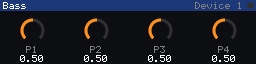

# Displays

Controllers like Push 2 or the MPC Studio Mk2 are MIDI devices with
screens driven another way: over USB bulk transfers or HID reports.
Character LCDs are driven by SysEx. Protocol 0.3 describes them, the host
reaches the devices, and the kit and its draw kit make the frames.

## In the protocol (0.3)

A descriptor lists its devices and displays.

**Devices** (`fsurf_device_spec_t`) are found by their USB vendor and
product ids. Each has:
- a role
- a transport (USB bulk or HID)
- for USB, the interface and endpoints
- for HID, the usage page and usage
- whether it is optional

The host opens them when it activates the surface and closes them after
deactivating it. While open:
- `host->device_write(device, bytes)` writes to a device.
- `surface->on_device(device, open)` says one opened or closed. A device
  comes and goes apart from the MIDI ports, so send everything when it
  opens.
- `surface->on_device_read` gives what a device sent.

**Displays** (`fsurf_display_spec_t`) each have a size, a pixel format, a
frame rate, and the device they go over (-1 for MIDI). The pixel formats
are:
- RGB565
- Push 2's BGR565
- RGB888
- 1-bit rows, or 1-bit pages for SSD1306 OLEDs
- text (characters and lines)

The host calls `surface->on_display_frame(display)` at each display's
frame rate. When it falls behind, it calls once rather than in a burst.
The surface draws what changed and sends it. It also hands the host what
the display shows (`host->display_mirror`, RGBA), so a virtual controller
can show it without the device.

## In the host library

The app does the actual USB and HID work through its `Host_Config`:
- `device_open(s, device, spec)` when a surface is activated
- `device_write` for the surface's writes
- `device_close` after it is deactivated

It reports reads with `instance_device_read`, on the surface thread, and
a device unplugged or back with `instance_device_state`.

`instance_display` gives what a display shows. The virtual controller
draws mirrored displays where the surface placed them (`virtual_display`,
and in `virtual_svg`).

The host library doesn't link libusb or hidapi itself: an app brings its
own (Pads does in stage 7).

## The draw kit (`draw`)

A `Canvas` holds 24-bit colour, whatever the display is. Drawing marks
what changed (`Canvas.dirty`), so a frame sends only when something did.

| | |
|---|---|
| Shapes | `clear`, `fill_rect`, `rect`, `fill_round_rect`, `line`, `hline`, `vline`, `circle`, `fill_circle`, `arc` (smooth edges), `blit` (images with alpha), `mix`, a clip rectangle |
| Text | `FONT_5X7` (bundled: printable ASCII), `text`, `text_width`, `text_in` (aligned and cut to a rectangle), any scale |
| Widgets | `meter` (green, yellow, red, a peak), `knob` (a 270° ring, or from the middle for pan), `param_label`, `bar`, `waveform` |
| Formats | `encode` (RGB565, BGR565, RGB888, 1-bit rows, 1-bit pages; the whole canvas or a region), `encode_push2` (Push 2's header, masked lines and padding), `rgba`, `png` |



## In the kit

```odin
spec := kit.Spec{
	...
	devices  = {{role = "display", transport = .Usb_Bulk, vendor_id = 0x1209, product_id = 0x0001, endpoint_out = 0x01}},
	displays = {
		{name = "Main", width = 256, height = 64, format = .Rgb565, fps = 30, device = 0},
		{name = "LCD", width = 16, height = 2, format = .Text, fps = 10, device = -1},
	},
}

main := kit.display(cs, 0)
main.draw = proc(d: ^kit.Display, cv: ^draw.Canvas) { ... }  // drawn after display_invalidate
kit.display_invalidate(main)                                   // when what it shows changes

lcd := kit.display(cs, 1)
lcd.text_line = proc(d: ^kit.Display, row: int, text: string, out: ^[dynamic]u8) { ... } // a line's SysEx
kit.display_text(lcd, 0, 0, "Bass")
```

At each frame the kit draws an invalidated display, and sends what
changed:
- by default: `prefix`, then the canvas in the display's format, over its
  device, in writes of up to `chunk` bytes
- `display_send_push2` for a Push 2
- or `send` of your own

It mirrors the display either way. When a device opens again, everything
is sent.

A text display sends only the lines that changed, each through
`text_line`, and mirrors as rendered text. `place_display` puts a display
on the device for tools, and `device_write` writes to a device directly.

[`examples/screen_odin`](../examples/screen_odin/screen.odin) has two
displays:
- a colour one over USB: the selected track in its colour, its device,
  and four parameters as knobs
- a 16x2 LCD over SysEx

In tests, the test host's devices are fakes:
- `written` gives what was written to each.
- `device_state` unplugs and replugs one, and `device_read` gives it
  something to read.
- `display_png` gives what a display shows, as a picture.

## Not yet

- Anti-aliased fonts (TrueType): the bundled font is a bitmap.
- Partial frames for devices that take regions: `encode` takes a region,
  but the kit's default send sends whole frames.
- A libusb or hidapi backend in the host library: it comes with Pads,
  with the Windows WinUSB, macOS permission and Linux udev questions from
  the design.
