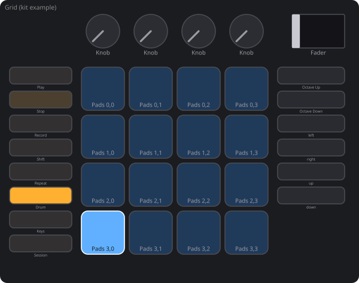

# Developer tools

What a surface's author works with, besides the test host
([kit.md](kit.md)):
- hot reload
- the MIDI monitor
- the log
- the virtual controller
- the `fsurf` command-line tool

All of it is in the host library, so any host built on it (Pads, in
stage 7) can show the tools in its own UI.

## fsurf.layout: the surface describes its hardware

The tools need to know what the device looks like and which control a
message is. A surface tells them through its own extension, `fsurf.layout`
([`include/fsurf_layout.h`](../include/fsurf_layout.h)), which the host
asks the surface for.

| Function | |
|---|---|
| `width`, `height` | the device's size, in its own units (millimetres, as a rule) |
| `count`, `get` | each control: name, kind (button, pad, encoder, fader), place, what it sends (message, channel, number, encoding, 14 bits) |
| `find(output, port, bytes)` | which control a message is, from the device or to it |
| `owner` | the component that has a control now |
| `state` | what a control shows: the last value sent, its colour (when the surface knows it), held or not, a fader's or ring's position |

The kit offers it for every surface:
- `place(control, x, y, w, h)` puts a control on the device, and
  `place_matrix(m, x, y, w, h, gap)` places a grid.
- The spec's `width` and `height` give the device's size.
- `skin_set_display(skin, name, 0xRRGGBB)` says what colour a skin value
  shows.

## The virtual controller

`host.virtual_open(instance)` reads the layout. Then:
- `Virtual.controls` holds each control, where it is.
- `virtual_state` gives what a control shows now.
- `virtual_press`, `virtual_release`, `virtual_turn` and `virtual_move`
  give the MIDI the device would send for a mouse action. The app hands
  it to `route` on the surface's input, as if from the device, so the
  claim table and the surface see it exactly as they would.
- `virtual_svg` draws the whole device as SVG:
  - controls lit as the surface lit them
  - held ones outlined
  - faders and encoders at their position



In tests, the test host names controls instead of bytes:

```odin
fst.press(&th, "Pads 3,0", 90)
fst.click(&th, "Play")
fst.turn(&th, "Knob", 3)
fst.move(&th, "Fader", 0.5)
st, _ := fst.shows(&th, "Play")   // st.value, st.rgb, st.pressed
os.write_entire_file("device.svg", transmute([]u8)fst.svg(&th))
```

## The MIDI monitor

`host.monitor_enable(&h, true)` records every message from a device, and
every message a surface sends it or hands on to the app. `route` records
on the MIDI thread without locking or allocating; `host_update` describes
what it recorded. Each entry (`monitor_entries`) gives:
- which way it went
- its bytes
- for a message from the device: what the claim table did, and which
  rule (a note off that followed its note on has none)
- the surface, the control and its owner, from the surface's layout

`monitor_line` turns an entry into text:

```
in  1  99 24 64  remap (rule 7)  Grid (kit example) / Pads 3,0 (Drum)
out 101  99 24 7F  Grid (kit example) / Pads 3,0 (Drum)
inj 1  99 24 64  Grid (kit example) / Pads 3,0 (Note Repeat)
```

It keeps `MONITOR_CAPACITY` entries, dropping the oldest. What `route`
records beyond that between updates is counted in `monitor_lost`.

## The log

Each line a surface logs (`log` in fsurf.h; in the kit, `kit.log` or
`core:log`) and each the host writes about one (a device that didn't
open, a library that didn't reload) is kept in the host's log, with its
time, level and surface. Each entry (`log_entries`) gives:
- its time (the host's clock, as the monitor's, so the two interleave)
- its level and where it came from (the surface, or the host)
- the surface, by uid and by name
- its text, and how many times it came in a row

`log_line` turns an entry into text:

```
12.345  info     Grid (kit example)  mode: mixer
12.400  warning  host: Grid (kit example)  its device "display" (2982:1967) isn't open
12.500  warning  Grid (kit example)  careful (x3)
```

- **Debug lines** are dropped unless `log_set_debug(&h, true)`, so a
  surface can leave its debug calls in. `Host_Config.log` still gets
  every line, debug ones too.
- **Bounded:** `LOG_PER_SURFACE` lines a surface (its oldest go first, so
  one that logs every message doesn't push out the others) and
  `LOG_CAPACITY` in all.
- **Repeats:** a line the same as its surface's last is counted on it.
- The app writes its own lines about surfaces with `log_add`.

## Hot reload

`host.library_load_watched(path)` loads a copy of the library and watches
the original.
- **When it reloads:** after you rebuild, once the file has stayed the
  same for `RELOAD_SETTLE_MS` (300).
- **What it keeps:** each of the library's surfaces keeps its Instance,
  device, ports and settings.
- **How:** the host saves each surface's project state, destroys it,
  loads a fresh copy (under a new name, so the system loads it anew),
  makes the surface again with its settings and that state, and activates
  it on the same ports.
- **What the device sees:** the old code's goodbye, then the new code's
  hello.
- **A broken build:** it doesn't load, so the old one goes on. The
  failure is logged and `Host_Config.on_reload` is told. The next change
  is tried again.
- **Library_reload** does the same at once.

## The fsurf tool

[`tools/fsurf`](../tools/fsurf/main.odin), built by `./scripts/build.sh`
into `.build/fsurf`:

```bash
fsurf scan                 # FSURF_PATH and the system's folders (or the folders given)
fsurf info Grid.fsurf      # its surfaces: ports, identity, extensions, and its controls
fsurf run Grid.fsurf --daw script.txt
```

`run` starts a surface on a headless host (with a fake fsurf.daw with
`--daw`) and runs a script (or reads commands from stdin), printing every
message as the monitor sees it, and what the surface logged and notified.

| Command | |
|---|---|
| `in 90 24 64` | MIDI from the device (hex) |
| `press NAME [VELOCITY]`, `release NAME`, `click NAME` | a control by its layout name |
| `turn NAME STEPS`, `move NAME VALUE` | an encoder, a fader (0-1) |
| `wait MS` | time passes: timers, tasks, and with `--watch` a rebuilt library reloaded |
| `svg FILE` | the device as it is now |
| `expect HEX` | fail (exit 1) unless the last command sent this |
| `daw` | the fake DAW's state |

```
> click Play
  in  1  B0 55 7F  claim (rule 5)  Grid (kit example) / Play (Transport)
  out 101  B0 55 7F  Grid (kit example) / Play (Transport)
  out 101  B0 56 05  Grid (kit example) / Stop (Transport)
  in  1  B0 55 00  claim (rule 5)  Grid (kit example) / Play (Transport)
```
